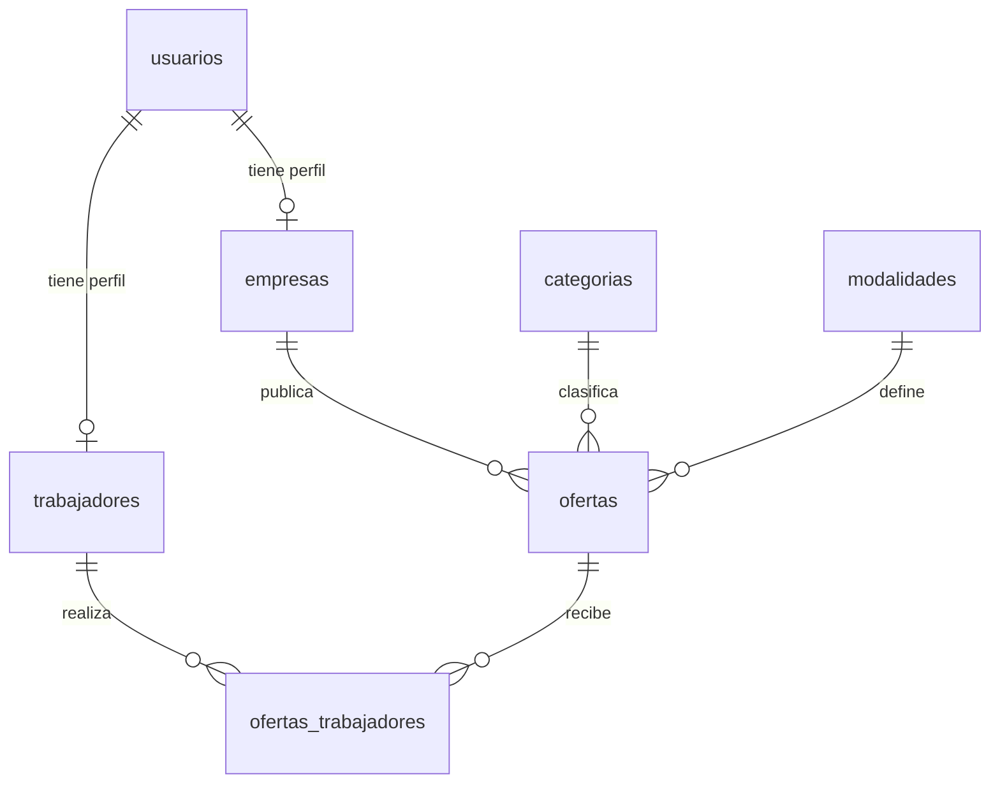
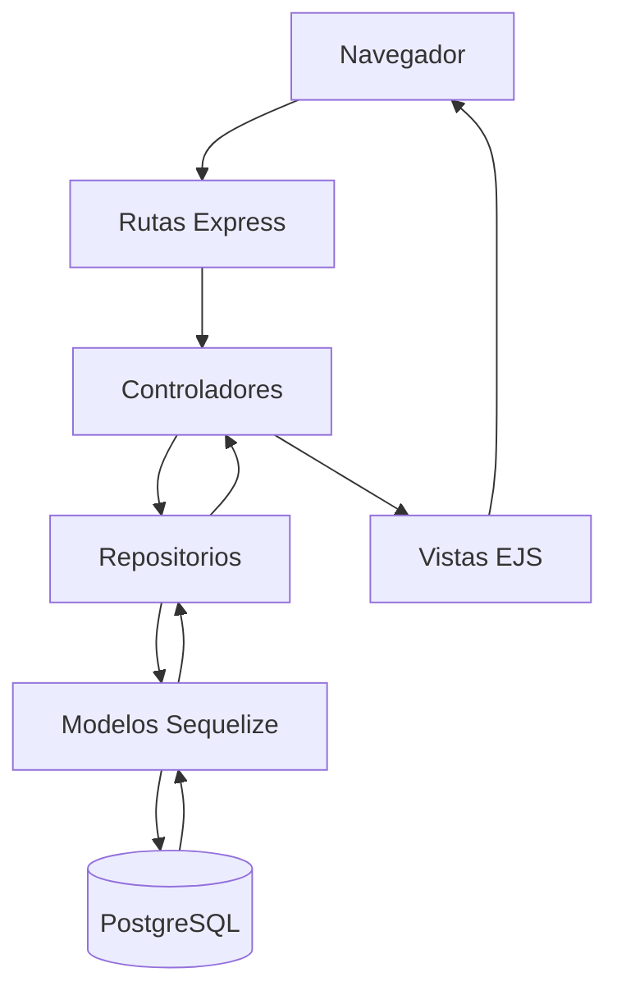

# CIBERJOB
## Memoria del proyecto grupal de Backend - Grupo 2

**Bootcamp The Bridge · Noviembre de 2026**

**Repositorio del proyecto:** https://github.com/reibax-dev/ciberjob

---

## Índice

- [CIBERJOB](#ciberjob)
  - [Memoria del proyecto grupal de Backend - Grupo 2](#memoria-del-proyecto-grupal-de-backend---grupo-2)
  - [Índice](#índice)
  - [1. Introducción y objetivos](#1-introducción-y-objetivos)
    - [1.1. Descripción del proyecto](#11-descripción-del-proyecto)
    - [1.2. Objetivos y alcance](#12-objetivos-y-alcance)
  - [2. Tecnologías y arquitectura](#2-tecnologías-y-arquitectura)
    - [2.1. Tecnologías utilizadas](#21-tecnologías-utilizadas)
    - [2.2. Arquitectura y organización del código](#22-arquitectura-y-organización-del-código)
    - [2.3. Entorno de desarrollo y ejecución](#23-entorno-de-desarrollo-y-ejecución)
  - [3. Diseño y funcionamiento](#3-diseño-y-funcionamiento)
    - [3.1. Funcionalidades principales](#31-funcionalidades-principales)
    - [3.2. Base de datos y relaciones](#32-base-de-datos-y-relaciones)
    - [3.3. Funcionamiento general de la aplicación](#33-funcionamiento-general-de-la-aplicación)
  - [4. Desarrollo del proyecto](#4-desarrollo-del-proyecto)
    - [4.1. Organización y reparto de tareas](#41-organización-y-reparto-de-tareas)
    - [4.2. Proceso de desarrollo y trabajo con Git](#42-proceso-de-desarrollo-y-trabajo-con-git)
    - [4.3. Decisiones técnicas](#43-decisiones-técnicas)
  - [5. Dificultades y soluciones](#5-dificultades-y-soluciones)
    - [5.1. Problemas encontrados](#51-problemas-encontrados)
    - [5.2. Soluciones aplicadas](#52-soluciones-aplicadas)
    - [5.3. Posibles mejoras futuras](#53-posibles-mejoras-futuras)
  - [6. Conclusiones](#6-conclusiones)

---

## 1. Introducción y objetivos

### 1.1. Descripción del proyecto

**Ciberjob** es un portal web de empleo ambientado en el mercado laboral del futuro. Su propuesta consiste en conectar empresas y trabajadores mediante ofertas de empleo de profesiones tecnológicas y futuristas.

Entre los empleos que pueden encontrarse en la plataforma se incluyen profesiones como la minería espacial, la implantación de microchips cerebrales o el trabajo en sistemas de teletransporte.

La aplicación permite a las empresas publicar ofertas de empleo y a los trabajadores consultar las oportunidades laborales e inscribirse en aquellas que les interesen.

### 1.2. Objetivos y alcance

El objetivo principal de Ciberjob es desarrollar una aplicación web funcional que permita gestionar información mediante un servidor, una base de datos relacional y una interfaz web.

**Objetivos técnicos:**

- Desarrollar un servidor utilizando Node.js y Express.
- Utilizar PostgreSQL como base de datos y Sequelize como ORM.
- Implementar operaciones CRUD (crear, consultar, actualizar y eliminar).
- Organizar el código mediante una arquitectura MVC con una capa de repositorios.
- Generar páginas HTML dinámicas utilizando EJS.
- Gestionar la autenticación de usuarios y los permisos según su perfil.
- Utilizar Docker Compose para ejecutar los servicios del proyecto.
- Desarrollar el proyecto de manera colaborativa mediante Git y GitHub.

**Alcance del proyecto:**

El proyecto contempla la gestión de usuarios, empresas, trabajadores y ofertas de empleo. Las ofertas pueden clasificarse mediante categorías y modalidades de trabajo, y los trabajadores pueden inscribirse en ellas.

Se contempla también un sistema de permisos que diferencia entre trabajadores, empresas y administradores, permitiendo que cada usuario gestione los registros que le corresponden.

Como posibles ampliaciones futuras se plantean funcionalidades como notificaciones, recomendaciones personalizadas de empleo o mensajería entre empresas y trabajadores.

---

## 2. Tecnologías y arquitectura

### 2.1. Tecnologías utilizadas

Para el desarrollo de Ciberjob se han utilizado las siguientes tecnologías:

| Componente            | Tecnología              | Función                                                            |
| --------------------- | ----------------------- | ------------------------------------------------------------------ |
| Entorno de ejecución  | Node.js 20              | Ejecutar JavaScript en el servidor                                 |
| Servidor              | Express 5               | Gestionar peticiones HTTP, rutas y middlewares                     |
| Plantillas HTML       | EJS                     | Generar las páginas web del portal                                 |
| Base de datos         | PostgreSQL 18           | Almacenar la información de la aplicación                          |
| ORM                   | Sequelize 6             | Acceder a PostgreSQL mediante modelos JavaScript                   |
| Entorno de desarrollo | Nodemon                 | Reiniciar automáticamente el servidor cuando se modifica el código |
| Contenedores          | Docker y Docker Compose | Ejecutar los servicios de la aplicación                            |
| Administración de BD  | pgAdmin 4               | Administrar y consultar la base de datos                           |
| Configuración         | dotenv / `.env`         | Gestionar variables de entorno y parámetros de configuración       |

### 2.2. Arquitectura y organización del código

Ciberjob utiliza una arquitectura basada en el patrón **MVC (Modelo-Vista-Controlador)**, incorporando una capa de repositorios para separar las operaciones de acceso a la base de datos.

La aplicación se organiza en las siguientes capas:

- **Rutas:** definen las URL y los métodos HTTP que atiende la aplicación.
- **Controladores:** reciben las peticiones, gestionan las operaciones y preparan las respuestas.
- **Repositorios:** contienen las consultas y operaciones de acceso a los datos mediante Sequelize.
- **Modelos:** representan las tablas de PostgreSQL mediante objetos JavaScript.
- **Vistas:** utilizan plantillas EJS para generar las páginas HTML que se muestran al usuario.
- **Middlewares:** realizan operaciones intermedias durante el procesamiento de las peticiones.

Esta separación permite mantener el código organizado, facilitar su mantenimiento y distribuir el desarrollo entre los integrantes del grupo.

**Estructura principal del proyecto:**

```text
ciberjob/
├── sql/                  # Scripts de la base de datos
├── src/
│   ├── config/           # Configuración de PostgreSQL
│   ├── controllers/      # Controladores de la aplicación
│   ├── middlewares/      # Funciones intermedias
│   ├── models/           # Modelos de Sequelize
│   ├── repositories/     # Acceso a los datos
│   ├── routes/           # Rutas web y API
│   ├── utils/            # Funciones auxiliares
│   ├── views/            # Plantillas EJS
│   └── index.js          # Archivo principal del servidor
├── .env.example
├── Dockerfile
├── docker-compose.yml
└── package.json
```

### 2.3. Entorno de desarrollo y ejecución

El proyecto utiliza **Docker Compose** para gestionar los diferentes servicios necesarios para su funcionamiento.

El archivo `docker-compose.yml` define tres servicios principales:

| Servicio | Tecnología        | Función                                                    |
| -------- | ----------------- | ---------------------------------------------------------- |
| app      | Node.js y Express | Ejecutar el servidor de la aplicación                      |
| postgres | PostgreSQL 18     | Almacenar los datos del portal                             |
| pgadmin  | pgAdmin 4         | Administrar la base de datos mediante una interfaz gráfica |

Estos servicios se comunican mediante la red interna de Docker.

Las credenciales, los puertos y otros parámetros de configuración se gestionan mediante variables de entorno definidas en el archivo `.env`.

Para iniciar el entorno se utiliza el comando:

```bash
docker compose up --build
```

La base de datos utiliza un volumen de Docker para conservar la información entre reinicios. Además, los scripts SQL permiten crear las tablas e introducir los datos iniciales cuando se inicializa la base de datos.

Esta configuración facilita que los integrantes del grupo puedan trabajar con un entorno de desarrollo similar, evitando diferencias entre sus equipos.

---

## 3. Diseño y funcionamiento

### 3.1. Funcionalidades principales

Ciberjob está diseñado para gestionar ofertas de empleo y conectar empresas con trabajadores, estableciendo diferentes funcionalidades según el tipo de usuario.

Los usuarios de la plataforma se dividen en cuatro grupos:

| Usuario       | Funcionalidades                                                                                                         |
| ------------- | ----------------------------------------------------------------------------------------------------------------------- |
| Visitante     | Sólo puede registrarse en la plataforma.                                                                                |
| Trabajador    | Consultar ofertas, inscribirse en ellas y gestionar su perfil y sus inscripciones.                                      |
| Empresa       | Publicar, consultar, modificar y eliminar sus propias ofertas de empleo, así como consultar los trabajadores inscritos. |
| Administrador | Gestionar todos los registros de la plataforma, independientemente de quién los haya creado.                            |

**Funcionalidades principales:**

- **Gestión de usuarios:** registro e inicio de sesión, diferenciando entre trabajadores, empresas y administradores.
- **Gestión de empresas y trabajadores:** creación, consulta, actualización y eliminación de los perfiles.
- **Gestión de ofertas:** publicación de ofertas de empleo con información sobre el puesto, descripción, salario, ubicación, categoría y modalidad.
- **Inscripciones:** los trabajadores pueden inscribirse en ofertas y cancelar sus inscripciones.
- **Clasificación de ofertas:** organización de las ofertas mediante categorías y modalidades de trabajo.
- **Control de permisos:** los usuarios pueden modificar o eliminar los registros que les pertenecen, mientras que los administradores tienen permisos generales.

Estas funcionalidades representan el comportamiento previsto de la plataforma.

### 3.2. Base de datos y relaciones

Ciberjob utiliza una base de datos relacional PostgreSQL, organizada en seis tablas principales y una tabla intermedia para gestionar las inscripciones.

| Tabla                  | Función                                                        |
| ---------------------- | -------------------------------------------------------------- |
| `usuarios`             | Almacena los datos personales y las credenciales de acceso.    |
| `empresas`             | Contiene los perfiles de las empresas.                         |
| `trabajadores`         | Contiene los perfiles de los trabajadores y sus currículums.   |
| `ofertas`              | Almacena las ofertas de empleo publicadas.                     |
| `categorias`           | Clasifica las ofertas según el tipo de empleo.                 |
| `modalidades`          | Define las modalidades de trabajo.                             |
| `ofertas_trabajadores` | Registra las inscripciones de los trabajadores en las ofertas. |

**Relaciones principales:**

- **Usuarios - Empresas (1:1):** cada empresa está vinculada a un usuario.
- **Usuarios - Trabajadores (1:1):** cada trabajador está vinculado a un usuario.
- **Empresas - Ofertas (1:N):** una empresa puede publicar varias ofertas.
- **Categorías - Ofertas (1:N):** una categoría puede estar asociada a varias ofertas.
- **Modalidades - Ofertas (1:N):** una modalidad puede estar asociada a varias ofertas.
- **Trabajadores - Ofertas (N:M):** un trabajador puede inscribirse en distintas ofertas y una oferta puede recibir inscripciones de varios trabajadores.

La relación N:M se implementa mediante la tabla intermedia `ofertas_trabajadores`, que utiliza una clave primaria compuesta para evitar inscripciones duplicadas.

**Diagrama entidad-relación:**



El diseño relacional permite mantener organizada la información y evitar duplicidades mediante claves primarias, claves foráneas y restricciones de integridad.

### 3.3. Funcionamiento general de la aplicación

Ciberjob funciona mediante una arquitectura cliente-servidor. Los usuarios interactúan con las páginas web generadas con EJS, mientras que Express procesa las peticiones y Sequelize permite acceder a PostgreSQL.

Cuando un usuario realiza una operación, como consultar una oferta de empleo, se produce el siguiente proceso:

1. El navegador envía una petición HTTP al servidor.
2. Express identifica la ruta correspondiente.
3. La ruta ejecuta el controlador encargado de gestionar la petición.
4. El controlador utiliza el repositorio para obtener o modificar información.
5. El repositorio realiza la operación correspondiente mediante Sequelize.
6. PostgreSQL devuelve los datos solicitados.
7. El controlador prepara la respuesta y, cuando corresponde, renderiza una vista EJS.
8. El navegador recibe y muestra la página resultante.

**Diagrama simplificado del funcionamiento:**



La aplicación está organizada para separar el procesamiento de las peticiones, el acceso a los datos y la presentación de la información.

---

## 4. Desarrollo del proyecto

### 4.1. Organización y reparto de tareas

Ciberjob se desarrolló en un equipo de cuatro integrantes. Para organizar el trabajo, se dividieron las responsabilidades principales por módulos, aunque durante el desarrollo también fue necesario colaborar en tareas de configuración, integración y corrección de errores.

El reparto de tareas fue el siguiente:

| Integrante    | Responsabilidades                                                                                                                                                                                                                                                           |
| ------------- | --------------------------------------------------------------------------------------------------------------------------------------------------------------------------------------------------------------------------------------------------------------------------- |
| **Eneko**     | Desarrollo de los módulos de usuarios y trabajadores, incluyendo operaciones CRUD, controladores, repositorios, modelos y vistas. Diseño y actualización de la base de datos, corrección de relaciones entre modelos e integración de usuarios con empresas y trabajadores. |
| **Jon Mikel** | Desarrollo del módulo de empresas, incluyendo operaciones CRUD mediante API y vistas EJS, modelos, repositorios, controladores y rutas. Elaboración de la memoria y documentación del proyecto.                                                                             |
| **Sergio**    | Desarrollo de los módulos de categorías y modalidades. Implementación de funcionalidades de autenticación, sesiones y permisos de usuario, integración de estilos CSS generados mediante inteligencia artificial y realización de correcciones generales.                   |
| **Xabi**      | Desarrollo del módulo de ofertas de empleo, incluyendo API, Sequelize, repositorios y vistas EJS. Configuración inicial del servidor, Docker y dependencias, organización de rutas, integración de módulos y resolución de errores de funcionamiento.                       |

El desarrollo se organizó mediante ramas de Git dedicadas a las distintas funcionalidades, permitiendo trabajar de forma paralela e incorporar los cambios progresivamente a la rama `dev` mediante *pull requests*.

A medida que avanzó el proyecto, las responsabilidades iniciales se ampliaron con tareas de integración, correcciones de nomenclatura, ajustes en la base de datos y adaptación de los diferentes módulos para que funcionaran conjuntamente.

Para el diseño visual se utilizaron herramientas de inteligencia artificial que permitieron generar los estilos CSS de la aplicación. Posteriormente, estos estilos se integraron y ajustaron dentro del proyecto.

Esta forma de organización permitió distribuir el trabajo, aunque también puso de manifiesto la importancia de mantener criterios comunes de programación, coordinar las modificaciones y revisar los cambios antes de integrarlos.

### 4.2. Proceso de desarrollo y trabajo con Git

El desarrollo se realizó de manera progresiva, comenzando por la preparación del entorno, el diseño de la base de datos y la estructura principal del servidor.

Posteriormente, se desarrollaron los distintos módulos de la aplicación, incorporando modelos, repositorios, controladores, rutas y vistas.

Para gestionar el código de manera colaborativa se utilizaron **Git y GitHub**, trabajando con diferentes ramas:

- **`main`:** rama principal del repositorio.
- **`dev`:** rama utilizada para integrar el desarrollo del proyecto.
- **Ramas de funcionalidades:** utilizadas para desarrollar los módulos de forma independiente antes de integrarlos.

Los cambios se registraban mediante commits y posteriormente se incorporaban a las ramas compartidas.

Este sistema permitió separar el trabajo individual del código común y facilitó la integración de las distintas funcionalidades.

### 4.3. Decisiones técnicas

Durante el desarrollo se tomaron varias decisiones relacionadas con la arquitectura, las tecnologías y la organización del proyecto.

| Decisión                                 | Justificación                                                                                        |
| ---------------------------------------- | ---------------------------------------------------------------------------------------------------- |
| Utilizar PostgreSQL                      | Permite almacenar la información mediante tablas relacionadas y mantener la integridad de los datos. |
| Utilizar Sequelize                       | Facilita las operaciones con la base de datos mediante modelos JavaScript.                           |
| Implementar MVC con repositorios         | Permite separar las responsabilidades y organizar el código por módulos.                             |
| Utilizar EJS                             | Permite generar páginas HTML dinámicas directamente desde el servidor.                               |
| Utilizar Docker Compose                  | Facilita la configuración de un entorno de desarrollo común para los integrantes.                    |
| Dividir el trabajo mediante ramas de Git | Permite desarrollar funcionalidades de manera independiente y posteriormente integrarlas.            |

Estas decisiones buscaron facilitar el desarrollo colaborativo, mantener el código organizado y aplicar los conocimientos adquiridos durante el módulo de backend.

## 5. Dificultades y soluciones

### 5.1. Problemas encontrados

Durante el desarrollo de Ciberjob surgieron diferentes dificultades relacionadas tanto con la programación como con la organización del trabajo en equipo.

Los principales problemas encontrados fueron:

- **Integración de los módulos y gestión de Git:** al trabajar cuatro integrantes en distintas ramas, surgieron imprevistos a la hora de integrar los cambios y mantener actualizado el código compartido.

- **Conocimientos técnicos:** el proyecto requirió aplicar conceptos de backend que todavía estábamos aprendiendo, especialmente relacionados con la arquitectura del servidor, las conexiones entre componentes y el acceso a la base de datos.

- **Errores de sintaxis:** pequeños errores de programación, como rutas incorrectas, importaciones o errores de escritura, provocaron fallos que en ocasiones resultaban difíciles de localizar.

- **Incompatibilidades de nomenclatura:** al desarrollar diferentes módulos de manera independiente, aparecieron diferencias en los nombres de funciones, variables y archivos, haciendo necesarias revisiones para la conexión entre las distintas partes de la aplicación.

- **Gestión de roles y permisos:** establecer qué operaciones podía realizar cada tipo de usuario y comprobar que se respetaban estas restricciones resultó más complejo de lo previsto.

Estas dificultades mostraron la importancia de la coordinación entre los integrantes, la organización del código y la necesidad de comprobar el funcionamiento de las distintas partes de la aplicación.

### 5.2. Soluciones aplicadas

Para afrontar las dificultades encontradas durante el desarrollo de Ciberjob se utilizaron diferentes estrategias de revisión, aprendizaje y coordinación entre los integrantes del equipo.

Las principales soluciones aplicadas fueron:

- **Revisión y depuración del código:** se revisaron archivos, rutas, importaciones y funciones para localizar errores de sintaxis y problemas de funcionamiento.

- **Uso de herramientas de inteligencia artificial:** se utilizaron como apoyo para comprender errores, resolver dudas técnicas y buscar posibles soluciones a problemas de programación.

- **Estandarización del código:** se tomó como referencia el modelo de arquitectura y programación proporcionado por el profesor para unificar criterios, nombres de funciones y organización de los archivos.

- **Coordinación entre integrantes:** se compartieron dudas y se revisaron las conexiones entre módulos para facilitar su integración dentro de la aplicación.

- **Gestión de versiones con Git:** se revisaron las ramas y los cambios realizados para resolver dificultades durante la integración del trabajo individual.

- **Pruebas de funcionamiento:** se realizaron comprobaciones de las distintas funcionalidades para detectar errores y verificar las correcciones aplicadas.

Estas estrategias permitieron resolver parte de las dificultades, mejorar la integración de los módulos y reforzar los conocimientos técnicos adquiridos durante el desarrollo del proyecto.

### 5.3. Posibles mejoras futuras

Aunque Ciberjob se ha desarrollado como un proyecto de aprendizaje, la plataforma ofrece posibilidades de ampliación.

Entre las posibles mejoras futuras se encuentran:

- **Notificaciones:** avisar a los trabajadores sobre nuevas ofertas de empleo o cambios en sus inscripciones.
- **Recomendaciones personalizadas:** sugerir ofertas según las preferencias y características del perfil del trabajador.
- **Mensajería interna:** facilitar la comunicación entre empresas y candidatos.
- **Mejoras en la búsqueda:** incorporar filtros más avanzados para localizar ofertas de empleo.
- **Mejoras de interfaz:** continuar perfeccionando el diseño visual, la navegación y la experiencia de usuario.

Estas ampliaciones permitirían mejorar la utilidad de la plataforma y desarrollar nuevas funcionalidades sobre la estructura existente.

## 6. Conclusiones

El desarrollo de Ciberjob nos ha permitido poner en práctica los conocimientos adquiridos durante el módulo de backend, trabajando en la creación de una aplicación web que integra un servidor, una base de datos y una interfaz de usuario.

A lo largo del proyecto hemos reforzado nuestros conocimientos sobre Node.js, Express, PostgreSQL, Sequelize y EJS, además de comprender mejor la importancia de organizar el código mediante una arquitectura estructurada por capas.

Uno de los mayores aprendizajes ha sido el trabajo colaborativo. La distribución de tareas, el uso de Git y GitHub y la integración de los distintos módulos nos han permitido experimentar con las dificultades de desarrollar una aplicación entre varios programadores.

Los problemas encontrados durante el desarrollo también han resultado útiles para mejorar nuestra capacidad de depuración, búsqueda de soluciones y comprensión del funcionamiento del backend.

En general, valoramos positivamente la experiencia. Ciberjob nos ha servido para consolidar conocimientos, identificar aspectos que debemos seguir mejorando y comprender la importancia de la planificación, la comunicación y la organización en el desarrollo de software.